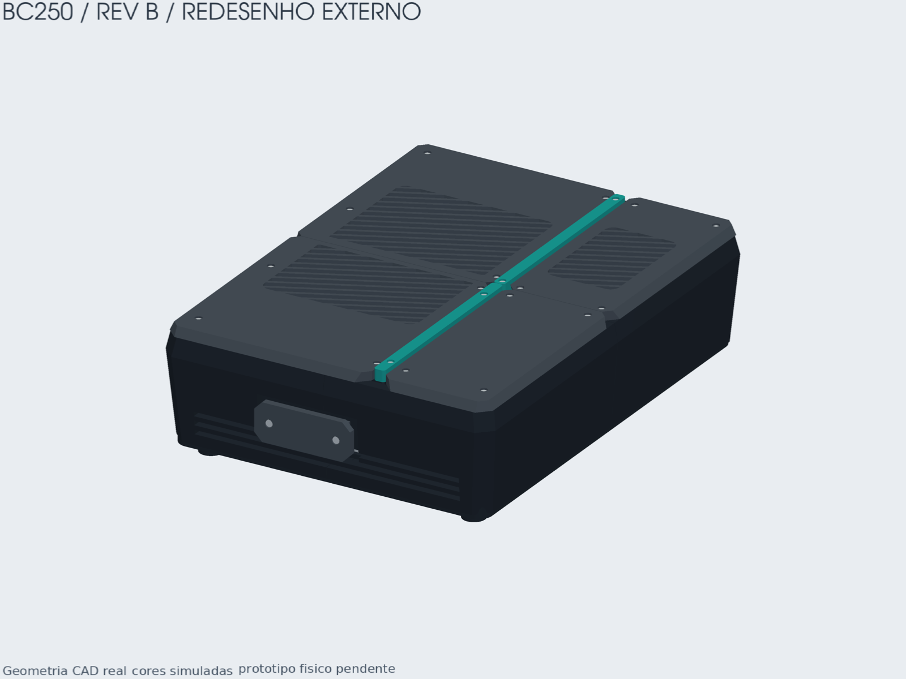
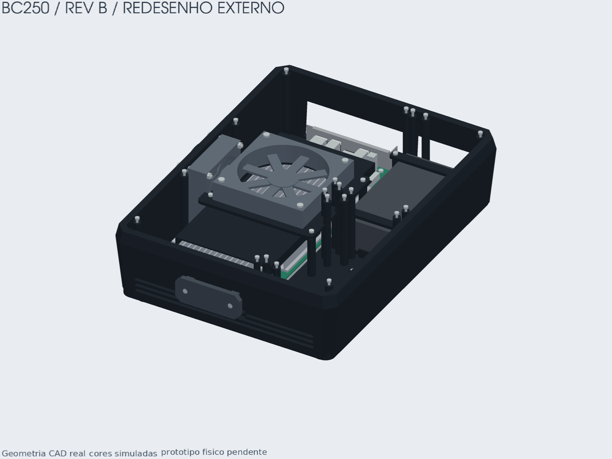
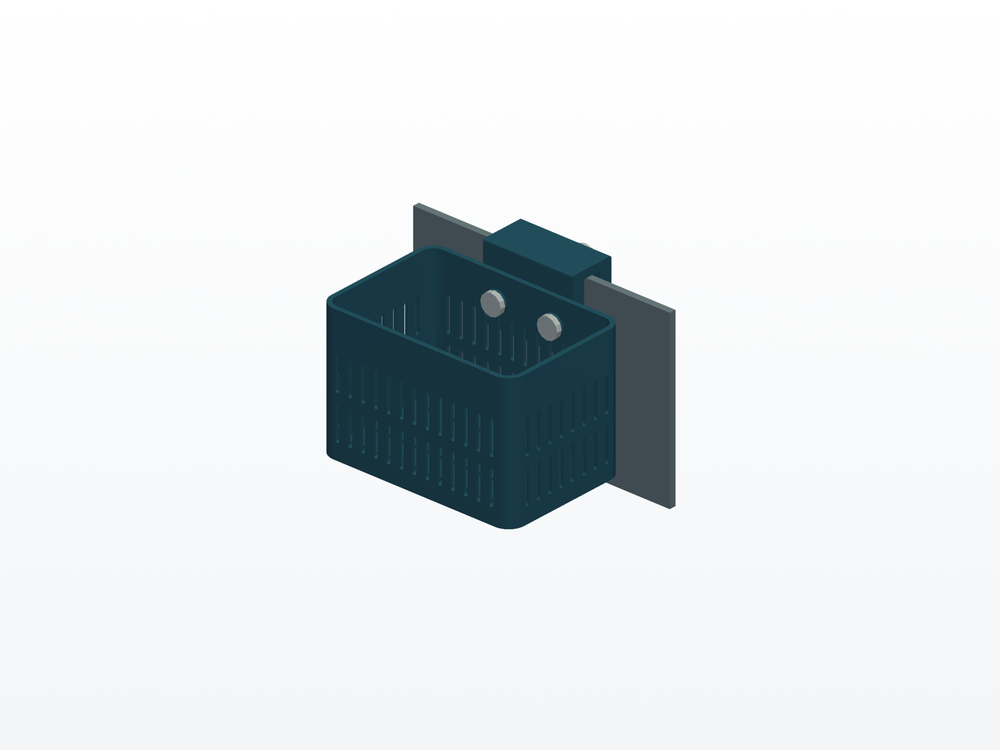
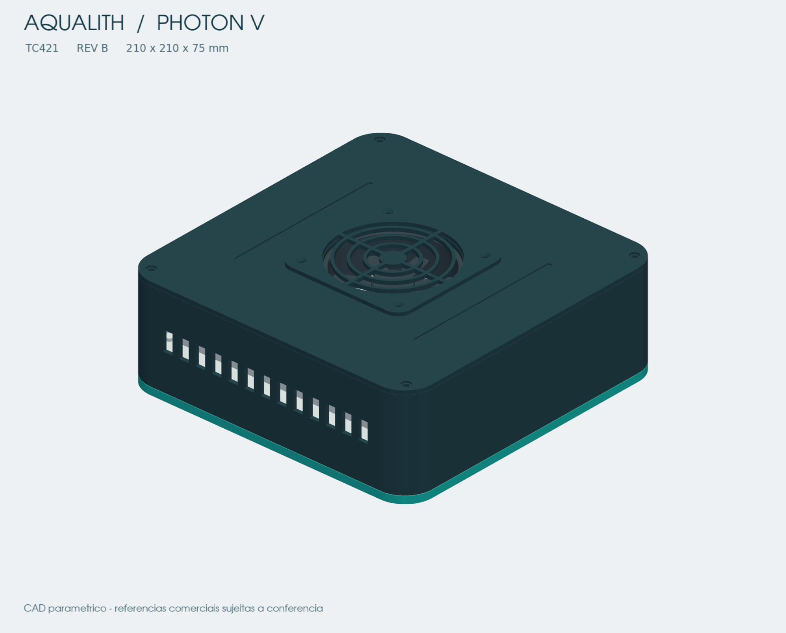
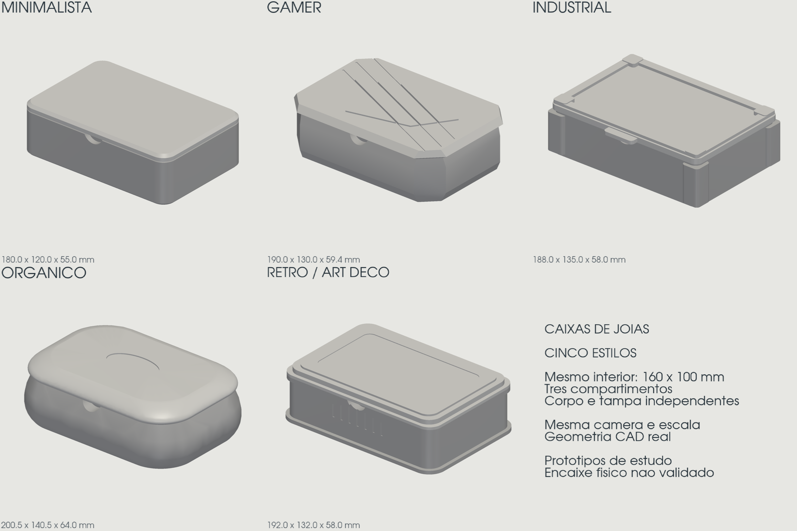
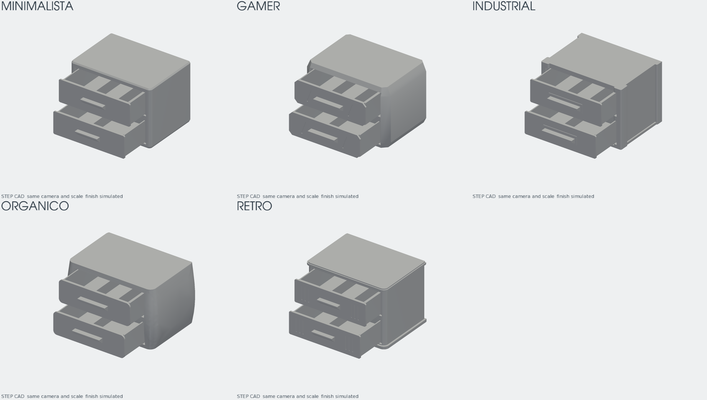

# Engenharia 3D e design de produtos

**Do briefing ao CAD paramétrico, com peças independentes, verificações e identidade de produto.**

Fluxo de **rrattes** para desenvolver objetos com Codex ou Claude Code, usando Python/build123d/OCP em Docker. A `3d-engineering` conduz requisitos e CAD; `toy-modeler` orienta a experiência de brinquedos; `product-design` acrescenta aparência quando solicitada. **Engenharia prevalece sobre design.**

[Começar um projeto](#início-rápido) · [Fluxo entre skills](docs/WORKFLOW.md) · [Instalação](docs/INSTALL.md) · [Créditos](THIRD_PARTY_NOTICES.md)

## Projetos desenvolvidos com o fluxo

As imagens abaixo são renders de geometria CAD dos projetos realizados. Materiais e cores são simulados. Elas mostram a aplicação do método; não comprovam fabricação ou desempenho físico. Esta galeria inclui imagens, sem distribuir automaticamente os STEP/STL completos desses produtos.

### Console gamer BC250

Projeto de gabinete com peças independentes, tampas removíveis, ventilação e organização interna. A Rev B aplica um redesenho externo com laterais inclinadas, ombros facetados e campos de ventilação oblíquos.



**Estado técnico:** a grelha lateral da Rev B permanece bloqueada para aceitação definitiva: houve redução de seção livre e a preservação do resfriamento ainda precisa ser demonstrada. A imagem apresenta o redesenho estudado, não uma solução termicamente aprovada.

<details>
<summary>Ver organização interna do console</summary>



Componentes comerciais são referências de montagem; as dimensões reais ainda precisam ser conferidas. Cor e render não substituem avaliação térmica ou montagem física.

</details>

### Cesta de anêmonas e luminária reef

| Cesta de anêmonas — Rev C | Aqualith Photon V — Rev B |
|---|---|
|  |  |
| Cesta em PETG de 150 × 100 × 100 mm, suporte para vidro de 4/5 mm e parafusos impressos com roscas diretamente nas peças. | Luminária de 210 × 210 × 75 mm com matriz de 32 LEDs, dissipação em alumínio, ventilação ativa e proteção óptica removível. |
| Exemplo de montagem, interfaces e fixadores próprios; fabricação e ensaios físicos pendentes. | Exemplo de integração mecânica e referências comerciais; validações térmica, elétrica, óptica e contra água pendentes. |

## Cinco estilos com product-design

A escolha de estilo se traduz em silhueta, proporções, transições, juntas e detalhes do CAD. O estilo é opcional, pode ser próprio ou combinado e precisa respeitar os requisitos técnicos. Não é necessário gerar cinco alternativas em todo projeto.



| Estilo | Decisões visíveis nestes estudos |
|---|---|
| **Minimalista** | Volumes simples, cantos suavizados e poucos detalhes. |
| **Gamer** | Superfícies facetadas, diagonais e recortes marcados. |
| **Industrial** | Cantos destacados, molduras e divisões visíveis. |
| **Orgânico** | Contornos arredondados e transições contínuas. |
| **Retrô / art déco** | Molduras em camadas, frisos e proporções escalonadas. |

Os corpos e as tampas das caixas são independentes. A comparação em cinza destaca diferenças de forma com câmera e escala comuns; encaixe físico não validado.

### A mesma proposta com duas gavetas

O segundo estudo aplica os cinco estilos a porta-joias com duas gavetas e compartimentos internos. A direção visual muda entre as variantes, mantendo a função comum.



As gavetas abertas mostram o interior; essa pose de apresentação não comprova movimento sem interferências. As imagens foram reaproveitadas dos projetos existentes, sem regeneração do CAD. [Origem e integridade das imagens](docs/images/gallery-sources.json).

## Como as skills trabalham juntas

**Conferir ambiente → briefing → plano → CAD e montagem → verificações técnicas → design opcional → rever impactos → entrega.**

| Etapa | Skills e ferramentas |
|---|---|
| Primeira utilização | Conferir skills necessárias, Docker/Compose e `cad3d doctor`. |
| Briefing e planejamento | `brainstorming`, `writing-plans` e `3d-engineering`. |
| Brinquedos | `toy-modeler` antes do CAD: ação, resposta, variação e observação do protótipo. |
| Modelagem e montagem | `executing-plans` + `3d-engineering`, com CAD no container. |
| Verificação e correção | Verificadores CAD e `systematic-debugging` quando necessário. |
| Aparência solicitada | `product-design`; mudanças de forma retornam às verificações afetadas. |
| Entrega | Evidências atuais, imagens, catálogo de peças e `verification-before-completion`. |

[Fluxo completo, auxiliares e economia de contexto](docs/WORKFLOW.md). Um projeto novo parte de seu próprio briefing; as medidas e soluções dos exemplos não são herdadas automaticamente.

## Versões

| Componente | Estado |
|---|---|
| 3d-engineering 1.8.0 | Estável aprovada |
| product-design evolução 03 | Aprovada e promovida; opcional após engenharia; comportamento parcialmente avaliado |
| toy-modeler 1.0.0 | Aprovada e promovida para protótipos pessoais; avaliação conceitual, protótipo físico pendente |
| product-design evolução 02 | Versão anterior preservada para recuperação |
| 26 skills auxiliares | Apoio ao fluxo/evolução; carregar somente as necessárias |

Este repositório distribui o método e suas ferramentas. As verificações CAD, fabricação, fatiamento e validação física são estados distintos. Os exemplos não são produtos homologados.

## Início rápido

Alvo inicial: Linux x86_64, Docker Engine com Compose v2, Git, Bash e Python 3. Dependências CAD ficam no container. WSL/macOS/ARM precisam de verificação própria.

```sh
git clone https://github.com/rrattes/3d-engeneering.git
cd 3d-engeneering
docker compose -f platform/compose.yaml build cad3d
./platform/scripts/cad3d doctor
export PATH="$PWD/platform/scripts:$PATH"
cad3d init projects/meu-produto
```

Abra Codex ou Claude Code nesta raiz e forneça um briefing novo. **Na primeira utilização, peça ao agente para conferir a disponibilidade das skills e do container antes de modelar.** As três skills próprias estão vinculadas no projeto para Codex (`.agents/skills`) e Claude Code (`.claude/skills`). Para que também apareçam em chats iniciados fora desta pasta, instale as skills necessárias no diretório global do agente conforme [instalação e uso](docs/INSTALL.md). Para brinquedos, invoque `toy-modeler` (no Codex, `$toy-modeler`) e siga o [handoff rápido](docs/toy-modeler/INICIO_RAPIDO.md). Leia o [fluxo atual](docs/WORKFLOW.md).

## Skills auxiliares

As 26 cópias estão em `third_party/skills`, com hashes, origem e diferenças registradas em [skills-manifest.json](third_party/skills-manifest.json). Foram usadas no desenvolvimento do método ou servem como apoio condicional das etapas; não são 26 etapas obrigatórias por produto.

Para disponibilizar uma auxiliar no agente, sem sobrescrever uma existente:

```sh
./scripts/enable-skill.sh codex brainstorming
./scripts/enable-skill.sh claude writing-plans
```

É possível repetir o comando com outras skills. Não instalar tudo globalmente nem carregar todo o catálogo por padrão. Memory Vault, MCPs e ferramentas externas citadas em auxiliares não são dependências obrigatórias do CAD3D.

## Estrutura

- `platform/`: CLI, Docker, perfis, templates, exemplos, testes e documentação técnica.
- `skills/`: as três skills próprias promovidas, fonte canônica.
- `third_party/skills/`: auxiliares com atribuição e licenças preservadas.
- `docs/`: instalação, fluxo, guia de economia e registros das versões.
- `.agents/skills/` e `.claude/skills/`: vínculos locais para descoberta.

## Evidências e versão promovida

A evolução03 tem **168 testes locais aprovados** na execução registrada antes desta publicação; não são testes executados pelo GitHub. Inclui evidência técnica vinculada, manifesto de entrega e permissões BREP. **20/36 respostas comportamentais** foram coletadas; faltam amostras e julgamento final. A promoção foi aprovada pelo usuário com essas pendências documentadas. [Registro da promoção](docs/product-design/promotions/evolution-03/APROVACAO_E_PROMOCAO.md).

<details>
<summary>Estudos adicionais de cor — mesmo CAD</summary>

Estes dois exemplos pertencem ao piloto da evolução03: somente cores simuladas mudam, com câmera e escala comuns.


</details>

## Licenças e créditos

Código próprio e skills próprias: **MIT**, copyright rrattes. [LICENSE](LICENSE).

Auxiliares: **Jesse Vincent / Superpowers**, **Affaan Mustafa / Everything Claude Code** e **OpenAI / skill-creator**, com suas licenças originais. Veja [créditos completos](THIRD_PARTY_NOTICES.md). A MIT do projeto não substitui as licenças dos terceiros. Fontes e receitas estão incluídas; imagens Docker e binários não fazem parte deste repositório.
