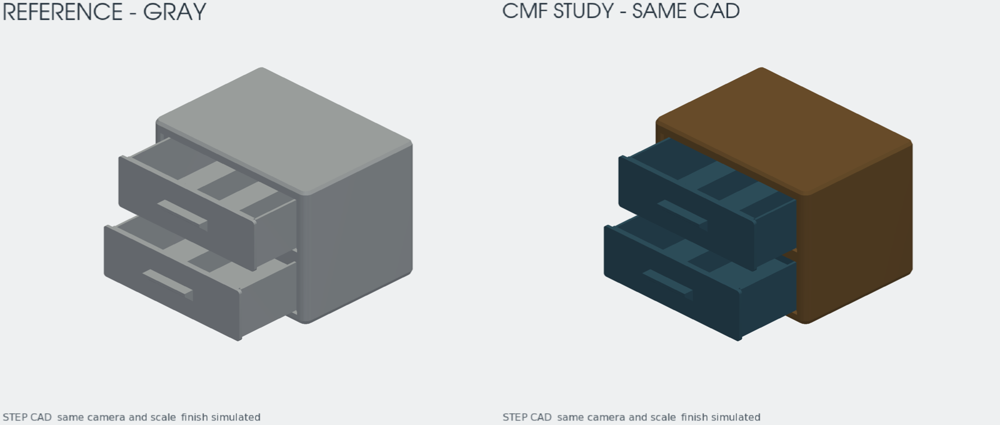
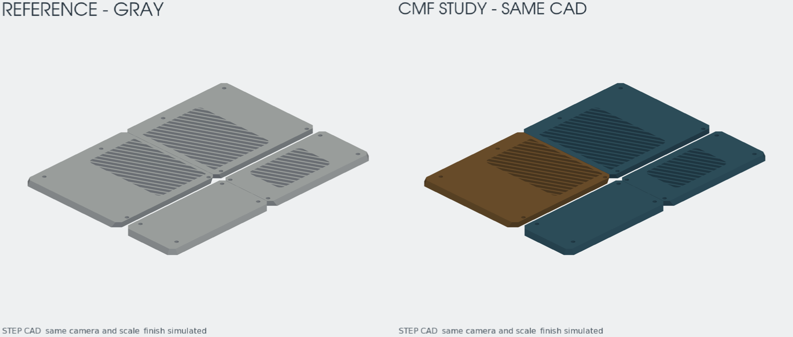

# Engenharia 3D e design de produtos

Fluxo de **rrattes** para desenvolver produtos com Codex ou Claude Code: briefing, arquitetura, CAD paramétrico, verificações, documentação e arquivos de fabricação. **Engenharia prevalece sobre design.**

## Versões

| Componente | Estado |
|---|---|
| 3d-engineering 1.8.0 | Estável aprovada |
| product-design evolução 03 | Aprovada e promovida; opcional após engenharia; comportamento parcialmente avaliado |
| product-design evolução 02 | Versão anterior preservada para recuperação |
| 26 skills auxiliares | Apoio ao fluxo/evolução; carregar somente as necessárias |

Este repositório distribui o método e suas ferramentas. As verificações CAD, fabricação, fatiamento e validação física são estados distintos. Os exemplos não são produtos homologados.

## Início rápido

Alvo inicial: Linux x86_64, Docker Engine com Compose v2, Git, Bash e Python 3. Dependências CAD ficam no container. WSL/macOS/ARM precisam de verificação própria.

```sh
git clone https://github.com/rrattes/3d-engeneering.git
cd 3d-engeneering
docker compose -f platform/compose.yaml build cad3d
./platform/scripts/cad3d doctor
export PATH="$PWD/platform/scripts:$PATH"
cad3d init projects/meu-produto
```

Abra Codex ou Claude Code nesta raiz e forneça um briefing novo. As skills próprias estão vinculadas em `.agents/skills` e `.claude/skills`; confira a descoberta no agente. Leia [instalação e uso](docs/INSTALL.md) e [fluxo atual](docs/WORKFLOW.md).

## Skills auxiliares

As 26 cópias estão em `third_party/skills`, com hashes, origem e diferenças registradas em [skills-manifest.json](third_party/skills-manifest.json). Foram usadas no desenvolvimento do método ou servem como apoio condicional das etapas; não são 26 etapas obrigatórias por produto.

Para disponibilizar uma auxiliar no agente, sem sobrescrever uma existente:

```sh
./scripts/enable-skill.sh codex brainstorming
./scripts/enable-skill.sh claude writing-plans
```

É possível repetir o comando com outras skills. Não instalar tudo globalmente nem carregar todo o catálogo por padrão. Memory Vault, MCPs e ferramentas externas citadas em auxiliares não são dependências obrigatórias do CAD3D.

## Estrutura

- `platform/`: CLI, Docker, perfis, templates, exemplos, testes e documentação técnica.
- `skills/`: as duas skills próprias estáveis, fonte canônica.
- `third_party/skills/`: auxiliares com atribuição e licenças preservadas.
- `docs/`: instalação, fluxo, guia de economia e estado da candidata.
- `.agents/skills/` e `.claude/skills/`: vínculos locais para descoberta.

## Evidências e versão promovida

A evolução03 tem **168 testes locais aprovados** na execução registrada antes desta publicação; não são testes executados pelo GitHub. Inclui evidência técnica vinculada, manifesto de entrega e permissões BREP. **20/36 respostas comportamentais** foram coletadas; faltam amostras e julgamento final. A promoção foi aprovada pelo usuário com essas pendências documentadas. [Registro da promoção](docs/product-design/promotions/evolution-03/APROVACAO_E_PROMOCAO.md).

### Imagens do piloto

São estudos de cor sobre CAD existente, com câmera e escala comuns; não representam redesenho ou certificação física.





## Licenças e créditos

Código próprio e skills próprias: **MIT**, copyright rrattes. [LICENSE](LICENSE).

Auxiliares: **Jesse Vincent / Superpowers**, **Affaan Mustafa / Everything Claude Code** e **OpenAI / skill-creator**, com suas licenças originais. Veja [créditos completos](THIRD_PARTY_NOTICES.md). A MIT do projeto não substitui as licenças dos terceiros. Fontes e receitas estão incluídas; imagens Docker e binários não fazem parte deste repositório.
